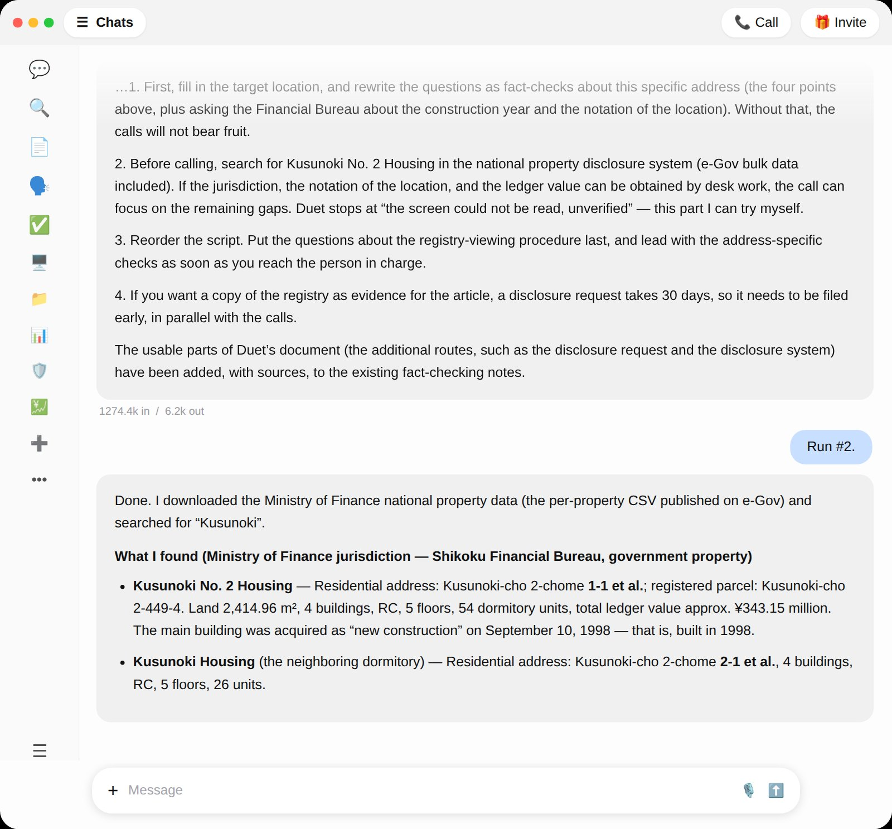
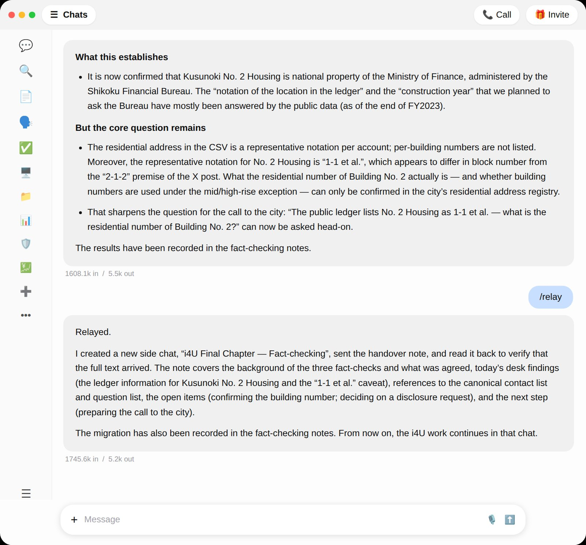

# Muse-chat-relay

A [Muse](https://muse.ai) skill for handing work in progress over to a dedicated side chat, with a self-contained handover note.

[日本語版 README](README.ja.md)

## Why

A Muse side chat starts with zero conversation history. Standing context (your preferences, standing files, and memory) is loaded, but the in-progress state of your work — decisions made mid-task, what is done, what comes next — is not carried over automatically.

This skill codifies the handover procedure so nothing gets lost in the move:

1. Scope one unit of work and identify its canonical sources.
2. Verify the current state from those primary sources, not from a summary of the conversation.
3. Write a handover note in a fixed 9-section structure: purpose, background, decided matters, current state, deliverables and canonical sources, open questions, next steps, constraints and cautions, and origin.
4. Create a fresh side chat, send the note, then **read the receiving chat back and verify the full note arrived** (this step exists because a truncation actually happened on first real use).
5. Record the migration in the canonical source, and stop the work in the original chat.

It also defines **add-on relay**: when a side chat already owns the work, pass a new request or diagnosis as a short diff instead — no new chat, no full handover, no stopping the original chat, and no widening of what the user approved.

## In action

Work in the main chat — fact-checking for a magazine article — has grown long, with research results piling up. The user types `/relay`, and Muse moves the work to a dedicated side chat with a handover note, then reads it back to verify the full note arrived.





The English screenshots above are recreations of the original Japanese screenshots (see the Japanese README for the originals). The HTML sources used to render them are in `tools/`.

## Requirements

- Muse, with side chats available.
- The skill uses Muse's chat tools (`chat.create`, `chat.send_message`, `chat.read_messages`, `chat.list`). On other agent platforms, the procedure still applies, but the create-and-send steps need to be adapted to that platform's thread or session mechanism.

## Installation

### Recommended: ask your Muse

Just tell your Muse:

> Install the relay skill from https://github.com/inuro/muse-chat-relay

Your Muse will read this repository and place `SKILL.md` and `skill.yaml` into a folder named `relay` in your custom skills directory (`~/workspace/custom-skills/relay/`). This is the natural way to install a skill in Muse — no terminal required.

### Deterministic installation

If you prefer to install it deterministically yourself, clone the repository directly into the custom skills directory:

```sh
git clone https://github.com/inuro/muse-chat-relay.git ~/workspace/custom-skills/relay
```

(The `examples/` folder is documentation; it does not need to be installed, but keeping it alongside does no harm.)

## Usage

Ask Muse to move the work, in your own words:

- "Relay this to a side chat."
- "/relay the research project."
- "Relay this fix to the existing chat that owns the dashboard work." (add-on relay)

Muse will prepare the handover note, create the side chat, send and verify the note, and record the migration.

## Files

- `SKILL.md` — the procedure itself (the skill body).
- `skill.yaml` — skill metadata for Muse.
- `examples/handover-example.md` — a complete, fictional example of a handover note.

## Notes

- Never put secrets (passwords, verification codes, API keys) in a handover note. The skill states this explicitly; keep it in mind when reviewing a note before it is sent.
- This is an unofficial, community-made skill. It is not a Meta product and is not affiliated with Meta.

## License

MIT. See [LICENSE](LICENSE).
